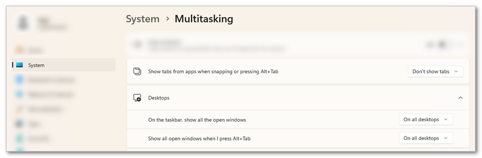

# close_virtual_desktop_win


<hr/>

### 👇  download (direct URLs - latest release)

- [  x86_64-pc-windows-msvc.zip](https://github.com/eladkarako/close_virtual_desktop_win/releases/latest/download/x86_64-pc-windows-msvc.zip)
- [  aarch64-pc-windows-msvc.zip](https://github.com/eladkarako/close_virtual_desktop_win/releases/latest/download/aarch64-pc-windows-msvc.zip)
- [  i686-pc-windows-msvc.zip](https://github.com/eladkarako/close_virtual_desktop_win/releases/latest/download/i686-pc-windows-msvc.zip)
- [ version.txt](https://github.com/eladkarako/close_virtual_desktop_win/releases/latest/download/version.txt)
- [ changelog.txt](https://github.com/eladkarako/close_virtual_desktop_win/releases/latest/download/changelog.txt)

<hr/>

## the problem.

I tend to open multiple virtual-desktops by mistake.  
opened apps are kept in another desktop, and I eventually open another copy.  
this makes <kbd>ALT</kbd>+<kbd>TAB</kbd>/<kbd>WIN</kbd>+<kbd>TAB</kbd> laggy.  

<hr/>

# what this program does.


it sends a key-combination (<kbd>WIN</kbd>+<kbd>CTRL</kbd>+<kbd>F4</kbd>) 32 times,  
it closes whatever desktop you are in, safely,  
moving all opened programs to a previously opened desktop.  
it does nothing if you are only having one desktop.  

you can run it manually,  
or as a scheduled-task.  

but it must be as part of user interactive session (logged-in).

<hr/>

## other, semi-working "tricks" I've tried..

- keep the virtual-desktop button ("taskview") in the taskbar always, and check from time to time (takes up space).

- try to disable it - registry (does nothing)

```reg
Windows Registry Editor Version 5.00

[HKEY_CURRENT_USER\SOFTWARE\Microsoft\Windows\CurrentVersion\Explorer\Advanced]
"MultiDesktopEnabled"=dword:00000000
"VirtualDesktopEnabled"=dword:00000000
"Multimon"=dword:00000000
```

- disable desktop creation hotkey (also disables every native `D` combination) - I've replaced it with AutoHotKey (kind of working).

```reg
Windows Registry Editor Version 5.00

;just D related key combination.
[HKEY_CURRENT_USER\SOFTWARE\Microsoft\Windows\CurrentVersion\Explorer\Advanced]
"DisabledHotkeys"="D"
```

- disable all antive win hotkey combination, and use AutoHotKey to set specific ones - (I've skipped this one, although it should be very effective).

```reg
Windows Registry Editor Version 5.00

;all WIN key combinations.
[HKEY_CURRENT_USER\SOFTWARE\Microsoft\Windows\CurrentVersion\Policies\Explorer]
"NoWinKeys"=dword:00000001
```

- install a newer windows build just to have somewhat more control over the key combination (not really did much).



<hr/>

here is an example for AutoHotKey script that does desktop reveal, as well as opening the desktop of this an another computer,  
it overrides the native key-combination so you don't have to worry about pre-disabling it (although it might work better if you do).  

```autohotkey
#Requires AutoHotkey v2.0
#SingleInstance  force         ; skip prompt and replace old instance automatically.
ListLines        false              ; disable key history / script lines listing for efficiency.
SetWorkingDir    A_ScriptDir  ; set working folder to be the script's folder.

;-------- desktop folder
#^d:: {
  Sleep 100  ; allow shell to restore

  Run A_Desktop,, "Max"

  ;--- alternative way to get special-folder desktop. in-case user has changed the folder from "C:\Users\" . A_UserName . "\Desktop" .
  ;static objShell := ComObject("Shell.Application")   ; local static reusable object (repeat key press will not re-create the object)
  ;static desktop_folder := objShell.Namespace(0)
  ;Run desktop_folder.Self.Path,, "Max"

  Sleep 100  ; allow shell to restore
}

;------------------- disable WIN+CTRL+LEFT/RIGHT from switching virtual desktops by mistake.
#^Left::return
#^Right::return

;-------- desktop folder - network device
#^+d:: {
  Sleep 100  ; allow shell to restore
  ;Run "\\other-computer\c$\Users\Elad\Desktop",, "Max"
  Run "N:\Users\Elad\Desktop",, "Max"
  Sleep 100  ; allow shell to restore
}

#d:: {       ;shell32 - "ToggleDesktop" verb, alternative is IShellDispatch::MinimizeAll / UndoMinimizeALL .
  Sleep 100  ; allow shell to restore
  static objShell := ComObject("Shell.Application")   ; local static reusable object (repeat key press will not re-create the object)
  objShell.ToggleDesktop()
  Sleep 100  ; allow shell to restore
}


;# = WIN
;! = ALT
;^ = CTRL
;+ = SHIFT
;https://eladkarako.github.io/docs_autohotkey_v2/docs/lib/Run.htm
;https://eladkarako.github.io/docs_autohotkey_v2/docs/misc/CLSID-List.htm
;https://eladkarako.github.io/docs_autohotkey_v2/docs/lib/HotIf.htm#IfWin
```

<hr/>

## slowness.

you'll see the immediate result, most likely right away,  
but the program still waits until the entire 32 key events will finish,  
which took about ~6 seconds.  
if you have more than 32 desktops, you can re-run the tool.  

- `Win + Ctrl + D` - create new desktop.
- `Win + Ctrl + F4` - close current desktop.
- `Win + Ctrl + ←/→` - cycle desktops.
- `Alt + Tab` / `Win + Tab` - surf apps across all desktops (configurable).

note: as far as I can tell, extra virtual-desktops by themselves are not the cause for low RAM or CPU spike,  
the cause is often when you "loose" an applications in another desktop ;)

<hr/>


## alternative.

if you want, you can use `autohotkey` instead of this program, you can even "compile" it to an exe.

```autohotkey
#Requires AutoHotkey v2.0

^!q:: CloseExtraDesktops()  ; Press Ctrl+Alt+Q to start

CloseExtraDesktops() {
    loop 32 {
        SendInput "{LWin down}{LCtrl down}{F4 down}{F4 up}{LCtrl up}{LWin up}"
        Sleep 200
    }
}
```

or even simpler:

```autohotkey
^!q::Loop 32 {
    Send "#^{F4}"
    Sleep 200
}
```

<hr/>

## better solutions (in the future, and reasoning).

There is no "close virtual-desktop" Windows API (yet).

Microsoft documents `IVirtualDesktopManager`, a COM interface available since Windows 10.  
It can tell you which desktop a window is on (`GetWindowDesktopId`),  
whether a window is on the current desktop (`IsWindowOnCurrentVirtualDesktop`),  
and even move a window to another desktop (`MoveWindowToDesktop`).  
It is implemented by the `VirtualDesktopManager` class, created with `CoCreateInstance`.  

It can't create, switch, or close desktops.  
Microsoft's guidance is that creating and manipulating desktops is reserved for the user,  
so the documented API doesn't offer that.  

Closing a desktop (currently) only works through the undocumented internal interfaces that tools like PowerToys use,  
which Microsoft doesn't support,  
or through the keyboard shortcut.

- https://learn.microsoft.com/en-us/windows/win32/api/shobjidl_core/nn-shobjidl_core-ivirtualdesktopmanager
- https://learn.microsoft.com/en-us/windows/win32/shell/virtualdesktopmanager
- https://github.com/microsoft/PowerToys/issues/6797

That's why your program simulates `Win+Ctrl+F4` with `SendInput`.  
It's the only public "route" for closing a desktop.  

- feel free to open a bug/feature request.  

<hr/>
<br/>

<a href="https://paypal.me/31adkarak0" target="_blank" rel="noopener noreferrer">


